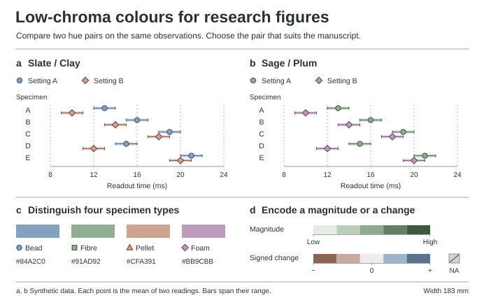

# Nature Manuscript Skills

用于科学论文写作和数据制图的两套可移植 skills。它们共同解决一个问题：**Results 里的每项判断，读者能否在相应面板上看到，并追到同一份数据？** 两套入口使用英文，详细指南使用中文，改写示范使用英文。这里的措辞偏好和配色属于编辑模板。投稿时另查目标期刊及文章类型的现行要求。[Nature 作者格式指南](https://www.nature.com/nature/for-authors/formatting-guide) · [Nature 官方制图规格](https://research-figure-guide.nature.com/figures/preparing-figures-our-specifications/)

| 要做的事 | 入口 |
|---|---|
| 写一节 Results、改首句、收紧机制解释或校审全文 | [写作 skill](skills/nature-manuscript-writing/SKILL.md) |
| 把研究目标、小节标题和各段第一句写清楚 | [标题与首句改稿示范](skills/nature-manuscript-writing/references/results-headings-and-openers.zh-CN.md)：同一份数据的提纲、退回稿与完整替换段 |
| 决定哪些实验进主文，哪些检查进补充，以及各段怎样递进 | [Results 的证据取舍](skills/nature-manuscript-writing/references/results-and-figures.md#实验是否值得占据正文) · [段内推理与段间递进](skills/nature-manuscript-writing/references/results-headings-and-openers.zh-CN.md#段内推理段间递进与段数) |
| 统一正文、图例、轴及图注里的术语与指代 | [术语与指代](skills/nature-manuscript-writing/references/terminology-and-referents.zh-CN.md) |
| 给结果图写一句发现，再按面板解释每个点和区间 | [整图图注与面板标题](skills/nature-research-figures/references/figure-workflow.zh-CN.md#图注和正文怎样配合) · [可复算的英文图注](skills/nature-research-figures/references/example.zh-CN.md) |
| 查名词、代词、形容词、副词、语态、时态及比较句 | [英语用法规程](skills/nature-manuscript-writing/references/english-usage.md) |
| 判断用词该删除、补证据、保留技术义，还是只在某个项目禁用 | [词语政策与例句](skills/nature-manuscript-writing/references/word-policy.md) · [可编辑检查词表](skills/nature-manuscript-writing/assets/prose-signals.tsv) |
| 设计图组、修复一个 panel，或对照图注和源表 | [绘图 skill](skills/nature-research-figures/SKILL.md) |
| 按论文目的选低饱和配色：两组比较、类别、大小或正负变化 | [低饱和选色指南](skills/nature-research-figures/references/muted-selection.zh-CN.md) · [点、线与色阶上的试样](skills/nature-research-figures/assets/muted-palette-proof.svg) · [可调的颜色配置](skills/nature-research-figures/assets/palettes.json) |
| 复现已有图或明确要求逐色匹配原卡 | [历史配置和图例](skills/nature-research-figures/references/colour-guide.zh-CN.md) · [十色色卡复绘](skills/nature-research-figures/assets/macaron-card.svg) |
| 查看一张图从原始观测到可交付文件的过程 | [合成示例、运行方式与验收](skills/nature-research-figures/references/example.zh-CN.md) |

## 先看一个图文联改例子

这张图使用合成数据。五个样本在两种设置下各读两次。若正文只写 *“B performed significantly better”*，会把读数的方向、比较单位和统计依据都留给读者猜。按图所支持的范围，可以这样写：

> Mean readout time was shorter under setting B than under setting A for each of the five specimens. The paired differences ranged from −3 to −1 ms and averaged −2.0 ms across specimens (Fig. 1b).

图 a 保留两个条件及两次读数的范围，图 b 用每个样本的两组均值计算 B − A。图注应解释区间两端是两次读数的最小值和最大值。结果只描述这里的五个样本；推广到其他样本需要另外的证据。[示例源数据](skills/nature-research-figures/assets/example-readings.csv)

## 颜色怎样选

共同的偏好是**低饱和度**。每张新图可以换色相。先问读者这一眼要看出什么，再决定颜色是否有用。

- **区分两个同等重要的来源：**可以选板岩蓝与陶土色，也可以选鼠尾草绿与灰梅紫。再用圆／菱形区分，让细线交叉时仍能认出对象。这两组是起点，没有规定某个来源必须是蓝色。
- **突出一个主要发现：**主结果用一个柔和色，背景比较用可读的灰。连续量由小到大，用同色相的明暗顺序；只有正负围绕有意义的零点时才用双向色阶。零与缺失分别标注。
- **同一论文已有图例：**同一个对象在读者需要横向比较的面板里保持一致。换一篇论文，或画一个语义不同的量，可以重新选色。缩到刊载宽度后若淡色标记看不清，先加深描边、改点形或直接标注，保留低饱和的观感。

只有要复现旧图，或明确要求完全采用原卡时，才回到[十色参考卡与归档方案](skills/nature-research-figures/references/colour-guide.zh-CN.md)。原卡保留了来源，不限制新图可用的色号。

## 安装与运行

解压或克隆整个仓库。将 `skills/` 下所需的完整子目录复制到当前账户的 `~/.codex/skills/` 或 `~/.claude/skills/`，并在新会话中点名 skill。也可以直接阅读 SKILL.md，无需安装。

- **写作请求示例**　“用 `nature-manuscript-writing` 修改这段 Results。保留比较范围，指出哪些词需要证据，交完整英文替换段。”
- **绘图请求示例**　“用 `nature-research-figures` 画出这两种设置的差异。给两种低饱和配色，在同一张配对图上比较，选成稿大小下更好认的那组。”

从仓库根目录运行。文字检查器只依赖 Python 3 标准库，示例图另需 Matplotlib。

~~~sh
python3 skills/nature-manuscript-writing/scripts/check_prose.py results.txt
python3 skills/nature-research-figures/scripts/render_example.py --out build
python3 skills/nature-research-figures/scripts/render_example.py --palette sage_plum --out build/sage-plum
~~~

词法命中是重读位置，不能证明句子有错。比如 *robust estimator* 可以是方法名；*the estimates were robust* 则要说明究竟经受了哪种扰动，以及结论改变多少。[检查器、术语锁与返回码](skills/nature-manuscript-writing/references/using-the-checker.md)
