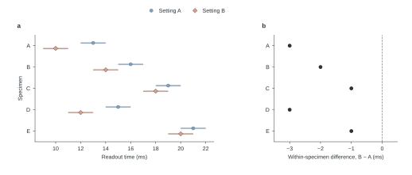
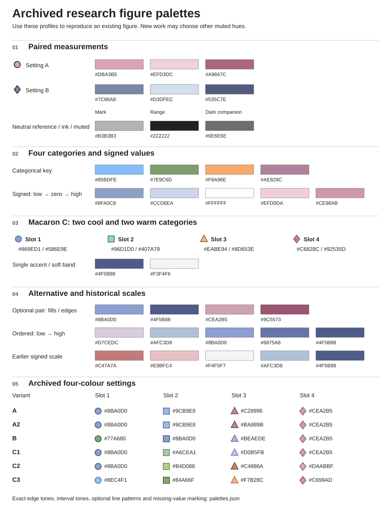

# Nature Manuscript Skills

用于科学论文写作和数据制图的两套可移植 skills。它们共同解决一个问题：**Results 里的每项判断，读者能否在相应面板上看到，并追到同一份数据？** 两套入口使用英文，详细指南使用中文，改写示范使用英文。这里的措辞偏好和配色属于编辑模板。投稿时另查目标期刊及文章类型的现行要求。[Nature 作者格式指南](https://www.nature.com/nature/for-authors/formatting-guide) · [Nature 官方制图规格](https://research-figure-guide.nature.com/figures/preparing-figures-our-specifications/)

| 要做的事 | 入口 |
|---|---|
| 写一节 Results、改首句、收紧机制解释或校审全文 | [写作 skill](skills/nature-manuscript-writing/SKILL.md) |
| 查名词、代词、形容词、副词、语态、时态及比较句 | [英语用法规程](skills/nature-manuscript-writing/references/english-usage.md) |
| 判断用词该删除、补证据、保留技术义，还是只在某个项目禁用 | [词语政策与例句](skills/nature-manuscript-writing/references/word-policy.md) · [可编辑检查词表](skills/nature-manuscript-writing/assets/prose-signals.tsv) |
| 设计图组、修复一个 panel，或对照图注和源表 | [绘图 skill](skills/nature-research-figures/SKILL.md) |
| 取 HEX、填充、描边、透明度、线型和标记 | [配色选择指南](skills/nature-research-figures/references/colour-guide.zh-CN.md) · [机器可读模板](skills/nature-research-figures/assets/palettes.json) |
| 查看一张图从原始观测到可交付文件的过程 | [合成示例、运行方式与验收](skills/nature-research-figures/references/example.zh-CN.md) |

## 先看一个图文联改例子

这张图使用合成数据。五个样本在两种设置下各读两次。若正文只写 *“B performed significantly better”*，会把读数的方向、比较单位和统计依据都留给读者猜。按图所支持的范围，可以这样写：

> Mean readout time was shorter under setting B than under setting A for each of the five specimens. The paired differences ranged from −3 to −1 ms and averaged −2.0 ms across specimens (Fig. 1b).

图 a 保留两个条件及两次读数的范围，图 b 用每个样本的两组均值计算 B − A。图注应解释区间两端是两次读数的最小值和最大值。结果只描述这里的五个样本；推广到其他样本需要另外的证据。[示例源数据](skills/nature-research-figures/assets/example-readings.csv)

## 颜色怎样选

先写颜色要区分的对象。两种来源用固定色和可辨认的标记，四种无序类别从分类色表取值。有正负方向且零点有解释意义时才使用发散色标。图例、正文用词和实际导出的标记必须指向同一对象。旧方案与当前推荐方案分别列在配色指南，不能仅凭颜色好看把不同角色混在一个图例中。

## 安装与运行

解压或克隆整个仓库。将 `skills/` 下所需的完整子目录复制到当前账户的 `~/.codex/skills/` 或 `~/.claude/skills/`，并在新会话中点名 skill。也可以直接阅读 SKILL.md，无需安装。

- **写作请求示例**　“用 `nature-manuscript-writing` 修改这段 Results。保留比较范围，指出哪些词需要证据，交完整英文替换段。”
- **绘图请求示例**　“用 `nature-research-figures` 将这份配对数据画成两面板。颜色和标记从模板读取，按实际刊载尺寸检查图和图注。”

从仓库根目录运行。文字检查器只依赖 Python 3 标准库，示例图另需 Matplotlib。

~~~sh
python3 skills/nature-manuscript-writing/scripts/check_prose.py results.txt
python3 skills/nature-research-figures/scripts/render_example.py --out build
~~~

词法命中是重读位置，不能证明句子有错。比如 *robust estimator* 可以是方法名；*the estimates were robust* 则要说明究竟经受了哪种扰动，以及结论改变多少。[检查器、术语锁与返回码](skills/nature-manuscript-writing/references/using-the-checker.md)
