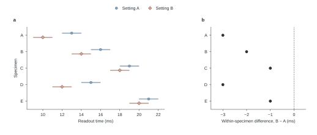

# 可运行示例：配对测量和差值来自同一张表



输入为[完全虚构的 CSV](../assets/example-readings.csv)，含五个试样、两个设置，每个试样在每个设置下有两次读数。本例仅演示图、数据和文字间的勾稽关系。

从该 skill 的目录运行：

```bash
python3 -m pip install matplotlib
python3 scripts/render_example.py --out build
```

这幅图的问题是“同一试样在 A、B 两个设置下相差多少”。因此给两个设置各用一个同等醒目的柔和色，配圆／菱形；差值面板只需墨色点和零参照，不再用冷暖暗示好坏。默认示例是板岩蓝／陶土色。若这两色在稿件中已代表别的类别，可运行 `python3 scripts/render_example.py --palette sage_plum --out build/sage-plum` 改用鼠尾草绿／灰梅紫。为新稿自选其他色相时，复制 JSON，修改其中一组的填色、描边和浅带，通过 `--palettes my-palettes.json --palette 组名` 读取。只需复现旧版玫瑰／石板图时用 `--palette archived`。每种选择使用相同的数据、图形和统计口径。

也可以用相同表头的自有数据运行 `python3 scripts/render_example.py --data readings.csv --out build`。每个试样占一行，每个设置恰好有两个有限、非负的时间值，试样标识必须唯一。生成 PDF、SVG、PNG 和含逐试样均值及差的 CSV。输入含缺测、负值、重复标识或不同重复数时，需要先按研究协议决定分母与纳入规则，并调整脚本。

**怎样读图。** Panel a 中，圆表示设置 A、菱形表示 B。点是两次读数的算术平均值，浅色线伸到这两次读数的最小值和最大值。Panel b 对每个试样取 B 的均值减去 A 的均值，虚线为零。例如试样 A，设置 A 的 12 和 14 ms 得到 13 ms；设置 B 的 9 和 11 ms 得到 10 ms。因此 b 的第一个点位于 −3 ms。五个配对差依次为 −3、−2、−1、−3、−1 ms，等权平均为 −2.0 ms。图中线段表示观察范围，没有给出置信区间。

**Results 示例。** Readout time was shorter under setting B for all five synthetic specimens. The mean paired difference was −2.0 ms (B minus A), with specimen differences ranging from −3 to −1 ms.

**Caption 示例。** Readout time under two settings. **a**, Mean time for each specimen under setting A (circles) and setting B (diamonds). Segments span the two readings for each specimen and setting. **b**, Within-specimen differences in mean readout time (B minus A). The dashed line denotes zero. Data are synthetic.

见[低饱和配色在数据标记上的试样](../assets/muted-palette-proof.svg)。复现历史色谱时，`python3 scripts/render_palette_atlas.py` 从同一个 JSON 读取旧稿配置，输出 [palette-atlas.svg](../assets/palette-atlas.svg)。换色后在相同观测上重新渲染，并复核图例与图注。
